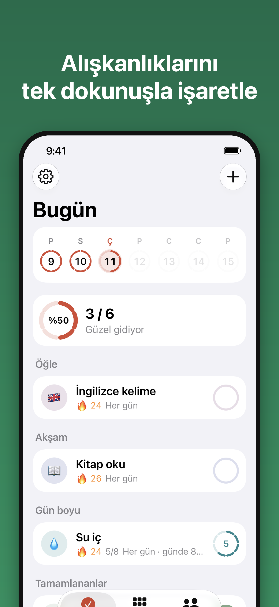
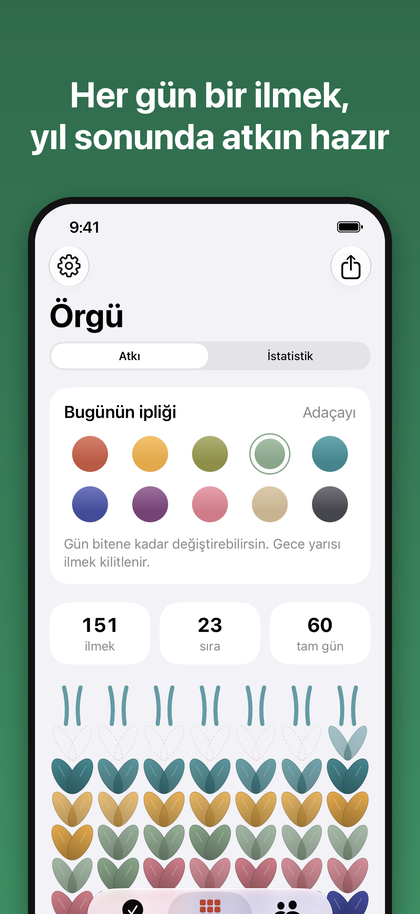
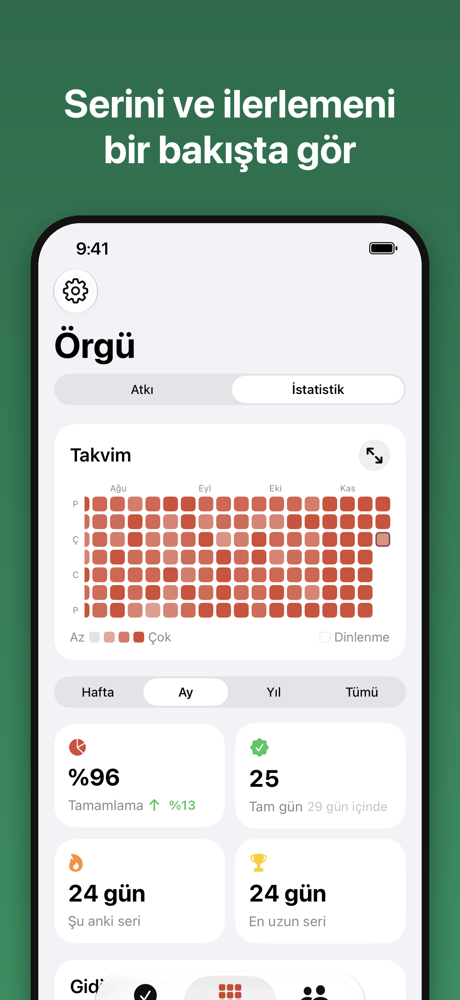
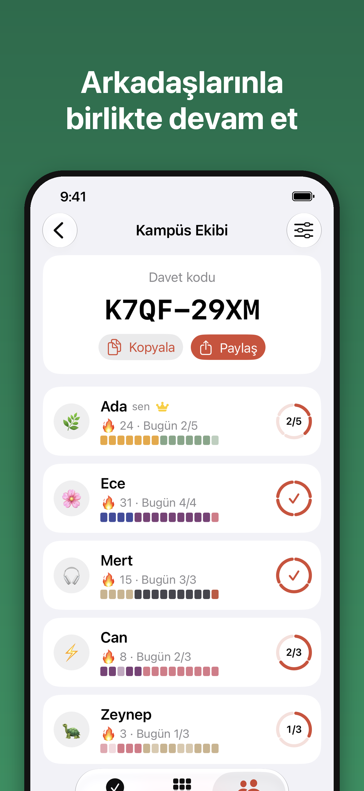
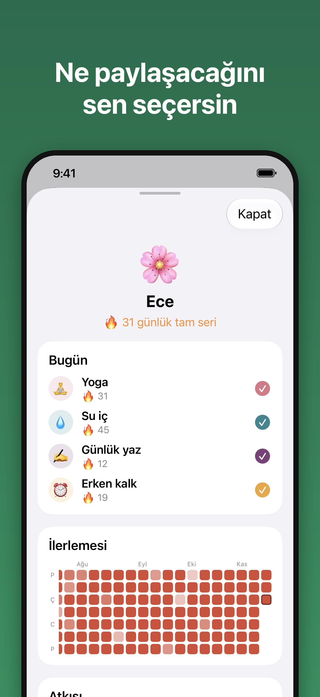
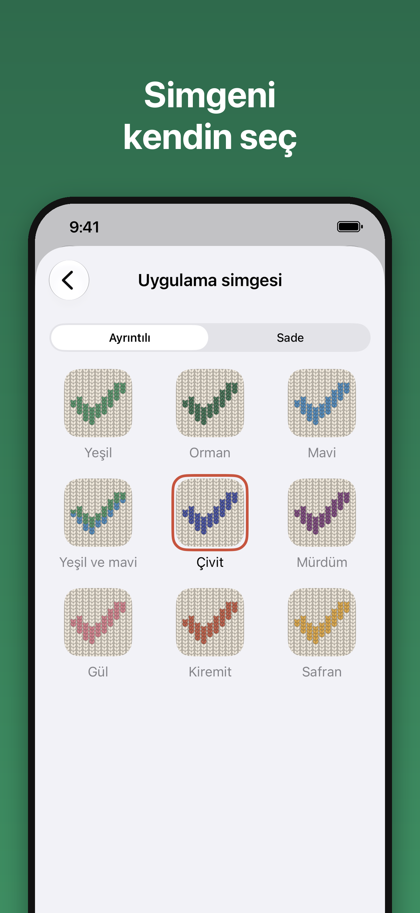
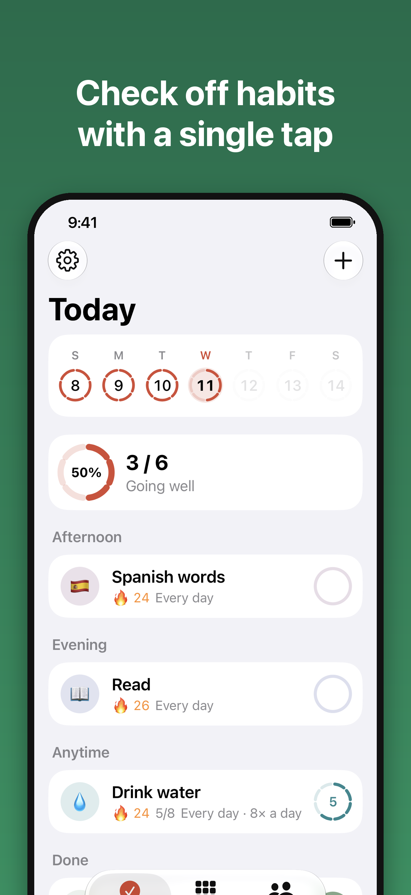
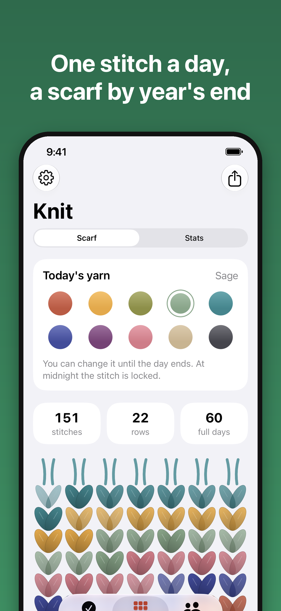
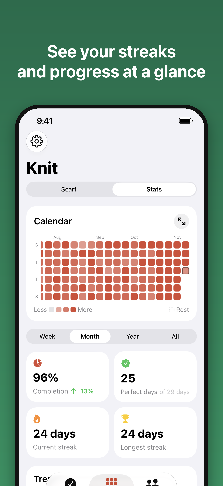

# İlmek

**Her gün bir ilmek at.** Alışkanlıkların ve ilaçların için sade bir takip uygulaması. Arkadaşlarınla bir grupta birbirinizi motive edersiniz. Ücretsiz, hesap yok, reklam yok, sunucu yok.

*A free iOS habit and medication tracker with friend groups. No accounts, no ads, no server. [English below](#english).*

<p>
  
  
  
</p>
<p>
  
  
  
</p>

## Özellikler

- **Esnek alışkanlıklar:** her gün, belirli günler, N günde bir, haftada ya da ayda N kez, günde birden fazla kez (ör. 8 bardak su).
- **İlaç hatırlatmaları:** sabit saatler ya da aralıklı hatırlatmalar (ör. 08:00–22:00 arası 6 saatte bir). İlaçlar varsayılan olarak gizlidir.
- **Seri ve istatistik:** seri, en iyi seri, takvim ısı haritası. Atlanan günler ve tatil modu seriyi bozmaz.
- **Örgü:** her gün bir ilmek. Zamanla alışkanlıklarından bir atkı örülür.
- **Arkadaş grupları:** kodla gruba katıl, sadece paylaşmayı seçtiğin alışkanlıklar görünür.
- **Widget:** ana ekrandan tek dokunuşla işaretleme.
- **Hesap yok:** veriler kendi iCloud hesabında durur. Uygulamayı silip yükleyince ya da yeni telefona geçince geri gelir.
- Türkçe ve İngilizce.

## Teknik

- SwiftUI + SwiftData, iOS 18+, Swift 6.
- Kişisel veriler **CloudKit private database** ile senkronlanır; grup özetleri **CloudKit public database** üzerinde. Kendi sunucusu yok.
- Saf mantık (`DayKey`, `Schedule`, `StreakEngine`, `ReminderPlanner`, `Knit`…) UI'dan bağımsız [`IlmekKit`](IlmekKit) paketinde, Swift Testing ile test edilir.

```
Ilmek/         SwiftUI uygulaması (Views, Services)
IlmekWidget/   Ana ekran widget'ı
IlmekKit/      Saf Swift mantık paketi + testler
Shared/        Uygulama ve widget'ın ortak SwiftData kodu
tools/         Çeviri, ikon ve ekran görüntüsü araçları
docs/          CloudKit şeması, gizlilik politikası, ekran görüntüleri
```

## Derleme

```bash
cd IlmekKit && swift test                 # mantık testleri
open Ilmek.xcodeproj                      # güncel Xcode
DEVICE_ID=<udid> ./deploy.sh              # bağlı iPhone'a kur ve aç
```

Kendi hesabınla derlemek için Xcode'da Signing & Capabilities altından takımı, bundle ID'yi ve iCloud container'ını değiştirmen gerekir. CloudKit şeması için [docs/CLOUDKIT.md](docs/CLOUDKIT.md).

---

## English

İlmek ("stitch" in Turkish) is a free iOS habit and medication tracker. Every day you complete your habits, you add a stitch; over time they knit into a scarf. Join a group with a code to keep each other going. Only habits you choose to share are visible to friends; medications are private by default.

- Flexible schedules, multiple times per day, medication reminders at fixed times or intervals.
- Streaks, best streaks, calendar heatmap; skipped days and vacation mode don't break a streak.
- Home screen widget.
- No accounts: your data lives in your own iCloud (CloudKit private database), groups use the CloudKit public database. No server.
- SwiftUI + SwiftData, iOS 18+. Pure logic in the `IlmekKit` Swift package with Swift Testing.
- Turkish and English.

<p>
  
  
  
</p>

[Privacy policy](docs/privacy-policy.md) · [Support](docs/support-page.md)
